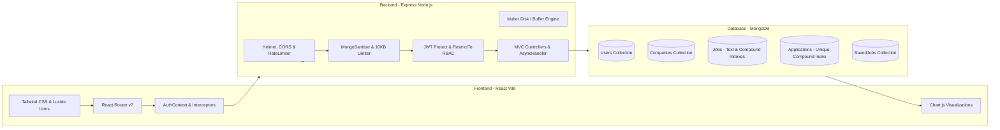
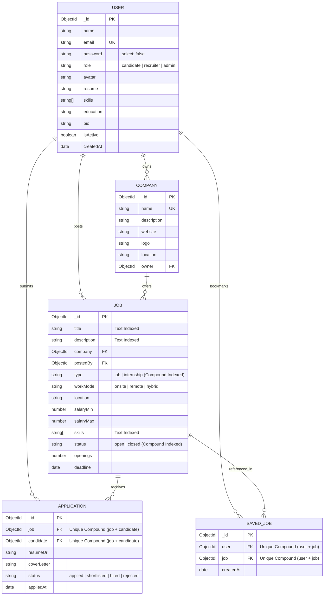

# OpportunityHub — Production-Grade Job & Internship Portal

> A full-stack, production-architected MERN web application engineered as a comprehensive college capstone project. Designed with strict Role-Based Access Control (RBAC), multi-layered security protections, high-performance database indexing, and role-aware analytical dashboards.

---

## 1. Quick Demonstration & Seed Credentials

For viva examiners and reviewers, the platform comes pre-seeded with verified test accounts across all three roles:

| Role | Email Address | Password | Permissions & Scope |
| :--- | :--- | :--- | :--- |
| **Admin** | `admin@example.com` | `AdminPassword123!` | System-wide governance, user activation/deactivation, job moderation, and aggregate time-series charts. |
| **Recruiter** | `recruiter@example.com` | `Password123!` | Employer company profile, job creation/editing/closure, candidate evaluation, and status progression. |
| **Candidate** | `candidate@example.com` | `Password123!` | Public job exploration, filters, one-click apply, bookmarking/saved jobs, and application tracking. |

> **Viva Tip**: On the frontend Login page, click the **1-Click Viva Demo** buttons (`Candidate`, `Recruiter`, or `Admin`) to immediately autofill and sign in without manual typing!

---

## 2. Architecture & Tech Stack



- **Frontend**: React 18, Vite 6, React Router 7, Axios, Tailwind CSS, react-hot-toast, Chart.js, react-chartjs-2, Lucide React.
- **Backend**: Node.js LTS, Express.js 4 (MVC pattern), REST API mounted strictly under `/api/v1`.
- **Database**: MongoDB with Mongoose ODM (compatible with local daemon and MongoDB Atlas).
- **Authentication**: Stateless JSON Web Tokens (`jsonwebtoken`) + `bcryptjs` (salt rounds: 12), RBAC roles (`candidate`, `recruiter`, `admin`).
- **Validation**: `express-validator` schema pipelines mapping into uniform `{ field, msg }` error envelopes.
- **Security**: `helmet`, strict `cors` whitelist, `express-rate-limit` (100 req/15min), `express-mongo-sanitize` (NoSQL injection defense), strict `10kb` body limits.
- **File Uploads**: `multer` with strict MIME filtering (`application/pdf`, `image/jpeg`, `image/png`) and 2MB hard size caps.
- **Logging**: `morgan` (dev & combined modes).
- **Automated Testing**: `jest` + `supertest` with 18 automated integration tests.
- **Containerization**: Multi-stage `Dockerfile` and `docker-compose.yml`.

---

## 3. Monorepo Project Structure

```text
Job & Internship Portal/
├── .github/
│   └── workflows/
│       └── ci.yml                 # GitHub Actions automated test & build workflow
├── backend/
│   ├── src/
│   │   ├── config/
│   │   │   ├── constants.js       # Central enums (ROLES, STATUSES, MODES)
│   │   │   ├── db.js              # Mongoose resilient connection logic
│   │   │   └── seed.js            # Database demo seeder script
│   │   ├── controllers/           # MVC Controllers
│   │   │   ├── application.controller.js
│   │   │   ├── auth.controller.js
│   │   │   ├── company.controller.js
│   │   │   ├── dashboard.controller.js
│   │   │   ├── health.controller.js
│   │   │   ├── job.controller.js
│   │   │   ├── savedJob.controller.js
│   │   │   └── user.controller.js
│   │   ├── middlewares/           # Security, Auth & Error Middlewares
│   │   │   ├── auth.middleware.js # protect + restrictTo RBAC
│   │   │   ├── error.middleware.js# Central error & 404 normalization
│   │   │   ├── upload.middleware.js # Multer 2MB PDF/PNG upload engine
│   │   │   └── validate.middleware.js
│   │   ├── models/                # Mongoose Schemas & Indexes
│   │   │   ├── Application.js     # Unique compound index { job: 1, candidate: 1 }
│   │   │   ├── Company.js
│   │   │   ├── Job.js             # Text search & { status: 1, type: 1 } index
│   │   │   ├── SavedJob.js
│   │   │   └── User.js            # Bcrypt salt 12 + select:false
│   │   ├── routes/                # Modular Express Routers
│   │   ├── utils/                 # ApiError, ApiResponse, asyncHandler, token
│   │   └── validators/            # express-validator rule chains
│   ├── tests/                     # Jest & Supertest Integration Suites
│   │   ├── auth.test.js
│   │   ├── health.test.js
│   │   ├── jobs.test.js
│   │   └── security.test.js
│   ├── uploads/                   # Local file storage target (gitignored)
│   ├── .env.example
│   ├── Dockerfile
│   ├── package.json
│   └── server.js                  # Process entry point
├── frontend/
│   ├── public/
│   │   └── _redirects             # SPA rewrite for Netlify
│   ├── src/
│   │   ├── api/
│   │   │   └── axios.js           # Axios client with JWT interceptor
│   │   ├── components/
│   │   │   ├── common/            # Navbar, Footer, Loader, EmptyState
│   │   │   ├── jobs/              # JobCard, ApplyModal
│   │   │   └── layout/            # MainLayout
│   │   ├── context/
│   │   │   └── AuthContext.jsx    # Session state & auto-hydration
│   │   ├── pages/
│   │   │   ├── admin/             # AdminDashboard, AdminUsers, AdminJobs
│   │   │   ├── candidate/         # CandidateDashboard, MyApplications, SavedJobs
│   │   │   ├── recruiter/         # RecruiterDashboard, PostEditJob, ManageJobs, Applicants
│   │   │   ├── Home.jsx           # Landing hero with search
│   │   │   ├── Jobs.jsx           # Filtered search & pagination
│   │   │   ├── JobDetails.jsx
│   │   │   ├── Login.jsx
│   │   │   ├── Register.jsx
│   │   │   ├── Profile.jsx
│   │   │   └── NotFound.jsx
│   │   ├── routes/
│   │   │   └── ProtectedRoute.jsx # Client-side RBAC route guard
│   │   ├── styles/
│   │   │   └── index.css          # Tailwind directives
│   │   ├── App.jsx                # Route hierarchy
│   │   └── main.jsx
│   ├── Dockerfile
│   ├── nginx.conf
│   ├── package.json
│   ├── tailwind.config.js
│   ├── vercel.json                # SPA rewrite for Vercel
│   └── vite.config.js
├── docs/
│   ├── JobPortal.postman_collection.json
│   └── JobPortal.postman_environment.json
├── docker-compose.yml
├── .gitignore
└── README.md
```

---

## 4. Database Schema Design & ER Diagram



---

## 5. Local Setup & Installation

### Prerequisites
- Node.js (v20+ recommended)
- MongoDB (Local instance or MongoDB Atlas free connection URI)
- Git

### Step 1: Clone and Configure Environment Variables
```bash
git clone <repository_url>
cd "Job & Internship Portal"
```

Configure backend environment:
```bash
cp backend/.env.example backend/.env
```
Edit `backend/.env`:
```env
PORT=5000
NODE_ENV=development
CLIENT_URL=http://localhost:5173
MONGO_URI=mongodb://127.0.0.1:27017/job_internship_portal
JWT_SECRET=super_secret_jwt_key_replace_with_high_entropy_secret_in_production
JWT_EXPIRES_IN=7d
MAX_FILE_SIZE_MB=2
```

### Step 2: Install Dependencies
```bash
# Install backend packages
cd backend
npm install

# Install frontend packages
cd ../frontend
npm install
```

### Step 3: Populate Demo Seed Data
Ensure MongoDB is running, then execute the seeder:
```bash
cd backend
npm run seed
```

### Step 4: Run Application
Start the backend server (Terminal 1):
```bash
cd backend
npm run dev
# Server listening on http://localhost:5000
```

Start the frontend client (Terminal 2):
```bash
cd frontend
npm run dev
# Vite client ready on http://localhost:5173
```

---

## 6. Complete REST API Reference (`/api/v1`)

| Method | Endpoint | Access Level | Description |
| :--- | :--- | :--- | :--- |
| `GET` | `/health` | Public | System uptime and database health check |
| `POST` | `/api/v1/auth/register` | Public | Register candidate or recruiter (rejects admin) |
| `POST` | `/api/v1/auth/login` | Public | Sign in with email and password, returns JWT |
| `GET` | `/api/v1/auth/me` | Protected | Fetch authenticated profile session |
| `PUT` | `/api/v1/auth/change-password` | Protected | Change existing account password |
| `POST` | `/api/v1/auth/forgot-password` | Public | Send 10-minute expiring password reset token |
| `POST` | `/api/v1/auth/reset-password/:token`| Public | Reset password with token from email |
| `PUT` | `/api/v1/users/profile` | Protected | Update profile with avatar and resume uploads |
| `GET` | `/api/v1/users` | Admin | Paginated user management table with search |
| `PUT` | `/api/v1/users/:id/status` | Admin | Activate or deactivate user account |
| `DELETE`| `/api/v1/users/:id` | Admin | Delete a user account permanently |
| `POST` | `/api/v1/companies` | Recruiter | Register company profile |
| `GET` | `/api/v1/companies/me` | Recruiter | Get recruiter's registered company |
| `GET` | `/api/v1/companies/:id` | Public | View company details |
| `PUT` | `/api/v1/companies/:id` | Recruiter/Admin| Update company details |
| `GET` | `/api/v1/jobs` | Public | Search, multi-filter, sort, and paginate jobs |
| `GET` | `/api/v1/jobs/:id` | Public | View single job details |
| `POST` | `/api/v1/jobs` | Recruiter | Publish a new job or internship |
| `PUT` | `/api/v1/jobs/:id` | Recruiter/Admin| Update existing job listing |
| `DELETE`| `/api/v1/jobs/:id` | Recruiter/Admin| Remove job listing |
| `GET` | `/api/v1/jobs/my` | Recruiter | List all jobs posted by current recruiter |
| `POST` | `/api/v1/jobs/:id/apply` | Candidate | Submit job application with cover letter |
| `GET` | `/api/v1/applications/my` | Candidate | List current student applications |
| `GET` | `/api/v1/jobs/:id/applications` | Recruiter/Admin| View all candidate submissions for a job |
| `PUT` | `/api/v1/applications/:id/status`| Recruiter/Admin| Update status (`shortlisted`, `hired`, `rejected`) |
| `DELETE`| `/api/v1/applications/:id` | Candidate | Withdraw submitted application |
| `POST` | `/api/v1/jobs/:id/save` | Candidate | Bookmark / save job |
| `DELETE`| `/api/v1/jobs/:id/save` | Candidate | Remove bookmark |
| `GET` | `/api/v1/saved-jobs` | Candidate | List candidate's saved jobs |
| `GET` | `/api/v1/dashboard/stats` | Protected | Role-aware analytics (Candidate, Recruiter, Admin) |

---

## 7. Automated Test Suite (Jest + Supertest)

The project includes 18 automated integration tests executed against ephemeral Express HTTP streams:

```bash
cd backend
npm test
```

### Test Coverage Matrix

| Test Suite | Test Cases Covered |
| :--- | :--- |
| **[health.test.js](file:///c:/Users/ayush/Videos/Job%20&%20Internship%20Portal/backend/tests/health.test.js)** | • Root `/health` operational status<br>• `/api/v1/health` JSON envelope and uptime verification |
| **[auth.test.js](file:///c:/Users/ayush/Videos/Job%20&%20Internship%20Portal/backend/tests/auth.test.js)** | • Input validation rejection on invalid fields<br>• Privilege escalation defense: rejects `role: 'admin'` at signup<br>• Minimum password length enforcement (min 6 chars)<br>• Rejection of unauthenticated requests (`401`)<br>• Rejection of forged JWT tokens (`401`)<br>• RBAC role check: candidates blocked from creating companies (`403`) |
| **[jobs.test.js](file:///c:/Users/ayush/Videos/Job%20&%20Internship%20Portal/backend/tests/jobs.test.js)** | • Public pagination envelope (`page`, `limit`, `total`, `pages`)<br>• Search and multi-filter query handling<br>• Recruiter authentication requirement for posting (`401`)<br>• RBAC: Candidate blocked from posting jobs (`403`)<br>• Title and description length validation (`400`)<br>• Candidate-only apply restriction (`403` for recruiters)<br>• Invalid ObjectId format validation (`400`) |
| **[security.test.js](file:///c:/Users/ayush/Videos/Job%20&%20Internship%20Portal/backend/tests/security.test.js)** | • Unmatched route 404 JSON normalization<br>• 10KB payload flood defense (`413 Payload Too Large`)<br>• Helmet security headers (`nosniff`, `dns-prefetch`) |

---

## 8. Manual QA & Edge-Case Verification Guide

| Test Scenario | Action Performed | Expected HTTP Status & Behavior |
| :--- | :--- | :--- |
| **1. Duplicate Email** | Register second user with existing email | `409 Conflict` — *"An account with this email address already exists."* |
| **2. Wrong Password** | Login with incorrect password | `401 Unauthorized` — *"Invalid email or password"* |
| **3. Missing Auth Token**| Request `/api/v1/auth/me` without Authorization header | `401 Unauthorized` — *"Authentication required. Please login."* |
| **4. IDOR Violation** | Recruiter A attempts `PUT /jobs/:id` for Recruiter B's job | `403 Forbidden` — *"You are not authorized to update this job listing"* |
| **5. Oversized Payload** | POST request containing body > 10KB | `413 Payload Too Large` — Request intercepted and blocked by Express body limiter |
| **6. Invalid File Upload**| Upload `.exe` or `.js` file to `/users/profile` | `400 Bad Request` — *"Invalid file type. Only PDF, JPG, and PNG files are allowed."* |
| **7. Duplicate Apply** | Candidate submits application twice to the same job | `409 Conflict` — Blocked by MongoDB unique compound index `{ job: 1, candidate: 1 }` |

---

## 9. Production Deployment Guide

### Option 1: Quick Deployment (Render + Vercel / Netlify)

1. **Database (MongoDB Atlas)**:
   - Create a free M0 cluster on [MongoDB Atlas](https://www.mongodb.com/atlas).
   - In **Network Access**, add `0.0.0.0/0` (Allow access from anywhere).
   - In **Database Access**, create a user and copy the connection string:
     `mongodb+srv://<username>:<password>@cluster0.mongodb.net/jobportal?retryWrites=true&w=majority`

2. **Backend (Render / Railway)**:
   - Connect your GitHub repository to [Render](https://render.com).
   - Create a new **Web Service**, set Root Directory to `backend`.
   - Build Command: `npm install`
   - Start Command: `node server.js`
   - Add Environment Variables:
     - `PORT`: `5000`
     - `NODE_ENV`: `production`
     - `MONGO_URI`: `<Your MongoDB Atlas URI>`
     - `CLIENT_URL`: `https://your-frontend.vercel.app` (Crucial: sets CORS correctly)
     - `JWT_SECRET`: `<High-entropy 32-character string>`
     - `JWT_EXPIRES_IN`: `7d`

3. **Frontend (Vercel / Netlify)**:
   - Import repository on [Vercel](https://vercel.com) or [Netlify](https://netlify.com).
   - Set Root Directory to `frontend`.
   - Build Command: `npm run build`
   - Output Directory: `dist`
   - Add Environment Variable:
     - `VITE_API_URL`: `https://your-backend.onrender.com/api/v1`
   - Notice: [vercel.json](file:///c:/Users/ayush/Videos/Job%20&%20Internship%20Portal/frontend/vercel.json) and [_redirects](file:///c:/Users/ayush/Videos/Job%20&%20Internship%20Portal/frontend/public/_redirects) are already preconfigured in the repository to guarantee single-page React Router navigation works without 404 on page refresh!

---

### Option 2: Production AWS Deployment (EC2 + PM2 + Nginx + Certbot SSL)

1. **Launch EC2 Instance**:
   - Ubuntu Server 24.04 LTS (t3.micro / t2.small) with security groups: 22 (SSH), 80 (HTTP), 443 (HTTPS).
2. **Install Node.js & PM2**:
   ```bash
   sudo apt update && sudo apt upgrade -y
   curl -fsSL https://deb.nodesource.com/setup_20.x | sudo -E bash -
   sudo apt install -y nodejs nginx git
   sudo npm install -g pm2
   ```
3. **Deploy Backend Service**:
   ```bash
   git clone <repo_url>
   cd "Job & Internship Portal/backend"
   npm install --omit=dev
   pm2 start server.js --name "job-portal-api"
   pm2 startup && pm2 save
   ```
4. **Configure Nginx Reverse Proxy**:
   Edit `/etc/nginx/sites-available/default`:
   ```nginx
   server {
       listen 80;
       server_name api.yourdomain.com;

       location / {
           proxy_pass http://localhost:5000;
           proxy_http_version 1.1;
           proxy_set_header Upgrade $http_upgrade;
           proxy_set_header Connection 'upgrade';
           proxy_set_header Host $host;
           proxy_cache_bypass $http_upgrade;
           proxy_set_header X-Forwarded-For $proxy_add_x_forwarded_for;
       }
   }
   ```
5. **Install SSL via Let's Encrypt**:
   ```bash
   sudo apt install -y certbot python3-certbot-nginx
   sudo certbot --nginx -d api.yourdomain.com
   ```

---

## 10. Containerization with Docker Compose

To run the entire ecosystem (MongoDB, Backend, and Frontend) in isolated Docker containers:

```bash
docker-compose up --build
```
- MongoDB starts on `localhost:27017`
- Express API starts on `localhost:5000`
- Nginx-served React SPA starts on `localhost:5173`

---

## 11. Git Workflow & 40+ Conventional Commit Sequence

```text
main (v1.0.0) ──●──●──●──●──●──●──●──●──●──●──●──●──●──●──●──●──● (Production)
                 \
feature branches  ●──●──● (feature/auth-api)
                  \
                   ●──●──● (feature/jobs-crud)
```

### Suggested Conventional Commit History:
1. `chore: initialize monorepo structure, backend setup and health check`
2. `feat(config): add constants, mongoose connection, and standard error classes`
3. `feat(auth): create User schema with bcrypt pre-save hashing`
4. `feat(auth): add JWT generation and nodemailer email helper`
5. `feat(auth): add express-validator rules for user registration and login`
6. `feat(auth): create auth controller with register, login, and getMe`
7. `feat(auth): implement protect and restrictTo RBAC middlewares`
8. `feat(auth): add password change and SHA-256 password reset flow`
9. `feat(company): add Company model and recruiter CRUD controllers`
10. `feat(jobs): add Job model with full-text search index and compound index`
11. `feat(jobs): create recruiter job publishing and ownership-verified editing`
12. `feat(applications): add Application model with unique compound index`
13. `feat(applications): implement candidate apply flow and duplicate prevention`
14. `feat(applications): create recruiter applicant review and status progression`
15. `feat(saved-jobs): implement SavedJob bookmarking and withdrawal endpoints`
16. `feat(jobs): add pagination, salary filtering, work mode filters, and sorting`
17. `feat(upload): configure Multer 2MB file upload middleware for avatars and resumes`
18. `feat(users): add user profile update and admin user management controllers`
19. `feat(dashboard): build role-aware MongoDB aggregation pipeline for stats`
20. `test(health): create Supertest health check verification suite`
21. `test(auth): add Supertest suites for validation and privilege escalation defense`
22. `test(jobs): add Supertest suites for pagination, search, and RBAC`
23. `test(security): add test cases for 10KB payload limit and Helmet headers`
24. `docs(postman): create complete Postman collection and environment`
25. `feat(frontend): initialize React 18, Vite, and Tailwind CSS configuration`
26. `feat(frontend): create Axios API client with token interceptor`
27. `feat(frontend): implement AuthContext session state and persistence`
28. `feat(frontend): create ProtectedRoute role guard component`
29. `feat(frontend): add Navbar, Footer, Loader, and EmptyState components`
30. `feat(frontend): build Home landing page with hero search bar`
31. `feat(frontend): create Login page with 1-click viva demo credentials`
32. `feat(frontend): create Register page with candidate and recruiter selector`
33. `feat(frontend): add ForgotPassword and ResetPassword flows`
34. `feat(frontend): build Jobs page with URL-synchronized multi-filters`
35. `feat(frontend): build JobDetails page with ApplyModal and save toggle`
36. `feat(frontend): create CandidateDashboard with status metrics`
37. `feat(frontend): create MyApplications page with status tracking and withdrawal`
38. `feat(frontend): build SavedJobs grid and Profile settings with file uploads`
39. `feat(frontend): create RecruiterDashboard and ManageJobs page`
40. `feat(frontend): build PostEditJob form and JobApplicants evaluation panel`
41. `feat(frontend): build AdminDashboard with Chart.js time-series graphs`
42. `feat(frontend): add AdminUsers table and AdminJobs moderation page`
43. `chore(security): complete UI polish, resolve npm audit advisories, and verify security checklist`
44. `ci: add GitHub Actions workflow and Docker Compose configuration`
45. `docs: add comprehensive production README, viva guide, and release v1.0.0`

---

## 12. Viva Defense & Examination Guide

### Common Questions & Answers:

1. **Q: How does the application prevent duplicate applications?**
   - **A**: Duplicate prevention is enforced at the database layer using a unique compound index: `applicationSchema.index({ job: 1, candidate: 1 }, { unique: true })`. Even under concurrent race conditions, MongoDB rejects duplicate insertions with an `E11000` duplicate key error, which our central error middleware catches and translates to `409 Conflict`.
2. **Q: Why is JWT used statelessly instead of traditional server-side sessions?**
   - **A**: Stateless JWTs avoid server-side session memory storage, allowing the backend API to scale horizontally across multiple instances or serverless containers without requiring centralized sticky sessions or distributed Redis session stores.
3. **Q: How does the app defend against NoSQL Injection?**
   - **A**: We apply `express-mongo-sanitize`, which recursively sanitizes incoming `req.body`, `req.query`, and `req.params` by stripping characters starting with `$` (MongoDB operators like `$gt`, `$ne`) or containing `.`.
4. **Q: Why is `select: false` configured on the User password field?**
   - **A**: It ensures that normal queries like `User.find()` or `User.findById()` will never include password hashes in their projection, preventing accidental leakage in JSON serialization, caching layers, or error logging.
5. **Q: How are monthly dashboard charts computed efficiently?**
   - **A**: Rather than fetching all jobs and iterating in JavaScript, we execute a native MongoDB aggregation pipeline using `$match`, `$group`, `$year`, and `$month`. The aggregation runs directly within MongoDB's C++ execution engine and returns pre-calculated monthly totals to Node.js in milliseconds.

---

## License & Project Credits
- **Project**: College Full-Stack Capstone Web Application
- **Author**: Sarika Singh
- **License**: MIT
